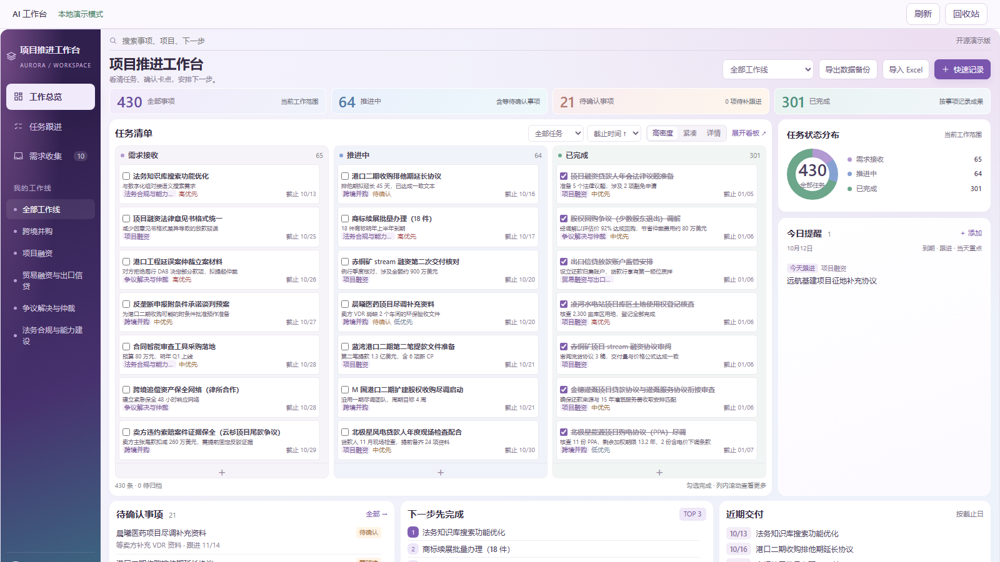
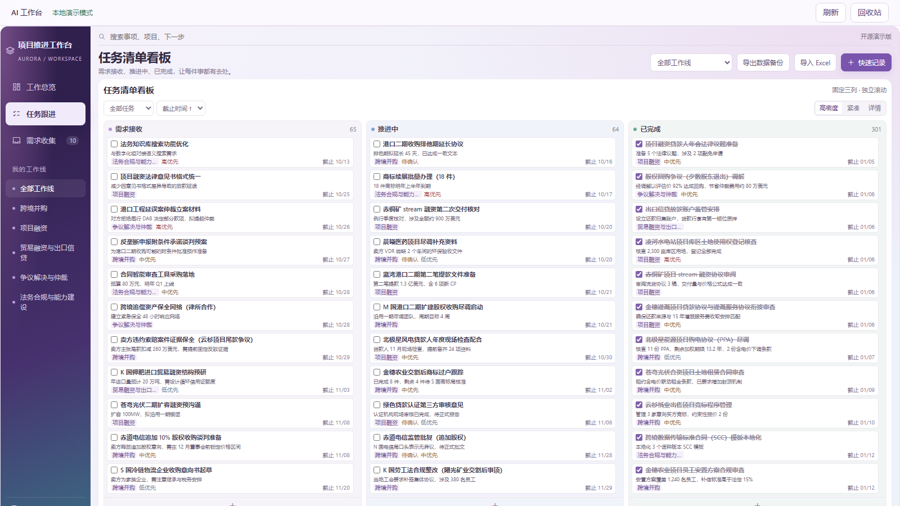
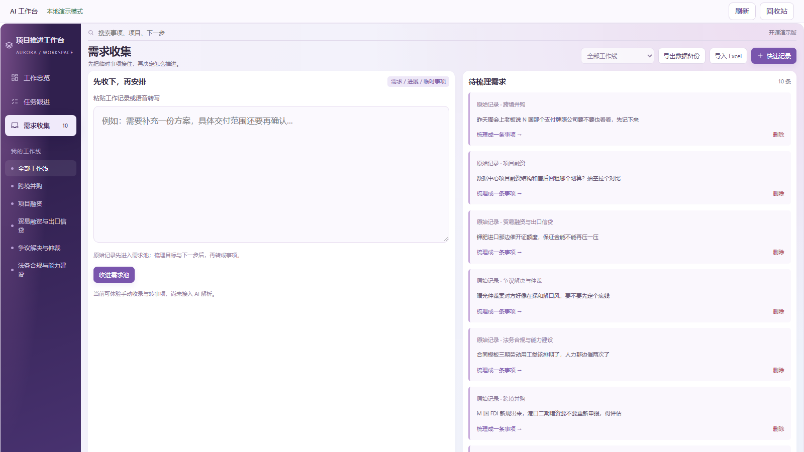

# AI 工作台（AI Workbench）

一个**自部署的个人项目推进工作台**：任务看板 + 需求收集池 + 回收站，数据云端同步、多端可用、离线可读。纯静态前端（原生 HTML/CSS/JS，零构建）+ 腾讯云开发 CloudBase（静态网站托管 + SQL 型数据库），全部源码约 1 MB，fork 之后按教程操作，**约 30 分钟即可部署出属于你自己的工作台**。



## 功能一览

- **任务看板**：待办 / 进行中 / 卡点等待 / 已完成四态管理，按「工作线」（自定义分类）分组筛选，点卡片标题即可全字段编辑；
- **需求收集**：临时事项先随手收进需求池，想清楚后再一键「梳理成一条事项」转成正式任务，没用的可以直接删；
- **回收站**：任务、需求删除后先进回收站（软删除），可恢复；每次操作带「撤销」toast；
- **Excel 批量导入 / 导出**：15 个固定字段，先预览后提交，适合一次性导入大量工作记录；
- **多人协作**：owner / editor / viewer 三种角色，成员管理走服务端鉴权；
- **可靠同步**：乐观锁 + 幂等请求 + 服务端校验 + 变更历史留痕，冲突时提示「重试 / 导出修改 / 放弃并拉取最新」；
- **离线可用**：Service Worker 缓存应用壳，断网可读最近数据（登录态与数据库响应不缓存）。




## 项目结构

```
src/
  index.html        主页面（登录页 + 总览 + 看板 + 需求池全部视图）
  config.js         ★ 唯一需要你改的文件：填入你的 CloudBase 环境 ID
  sw.js             Service Worker（缓存应用壳，改代码必须 bump 里面的缓存名）
  assets/
    cloud.js        CloudBase SDK + 云端同步桥接逻辑
    cloud.css       界面样式
    v8-app.js       工作台应用主逻辑
    jszip.min.js    Excel 导入依赖
database/
  setup.sql         ★ 建库脚本：5 张表 + 约束 + 4 个数据库函数，一次跑完
examples/
  demo-data.json    430 条虚构演示数据（国际投融资法务场景），仅供了解数据结构
screenshots/        README 用图
```

> 说明：本项目没有传统意义上的"云函数"。服务端逻辑是 **SQL 型数据库（PostgreSQL）里的 4 个数据库函数**（`awb_snapshot` 读取快照、`awb_apply` 提交修改、`awb_members_list` / `awb_member_set` 成员管理），前端通过 PostgREST 风格的 RPC 调用，鉴权在函数内完成。

## 部署教程（从零到你的专属工作台）

前置条件：一个腾讯云账号（CloudBase 有个人版套餐，约 20 元/月）。全程在网页控制台点选，不需要写代码。

### 第 1 步：创建 CloudBase 环境

1. 打开[腾讯云开发 CloudBase 控制台](https://console.cloud.tencent.com/tcb)，开通服务；
2. 新建环境：名称随意（如 `my-workbench`），地域选上海，套餐选个人版；
3. 记下**环境 ID**（形如 `my-workbench-xxxxxxxx`）。

### 第 2 步：初始化数据库

1. 进入环境 → 左侧「SQL 型数据库」→「SQL 编辑器」；
2. 把本仓库 `database/setup.sql` **整段粘贴**进去，点「执行」；
3. 执行成功后，左侧「数据编辑器」里应能看到 `awb_workspaces`、`awb_members`、`awb_records` 三张表。

### 第 3 步：创建你的登录账号

1. 左侧「身份认证」→「登录方式」，开启**用户名密码登录**；
2. 「用户管理」→ 新建用户：设置你的用户名和密码；
3. 建好后在用户列表里**复制该用户的 UID**。

### 第 4 步：把自己设为工作空间管理员

回到「SQL 编辑器」，执行（把 `<你的UID>` 换成上一步复制的值）：

```sql
INSERT INTO public.awb_workspaces(id,name) VALUES('main','我的工作台');
INSERT INTO public.awb_members(workspace_id,user_id,display_name,role,enabled)
VALUES('main','<你的UID>','管理员','owner',true);
```

### 第 5 步：改配置、上传前端

1. 下载本仓库源码，打开 `src/config.js`，把 `"your-env-id"` 改成第 1 步的环境 ID；
2. 控制台 → 左侧「静态网站托管」→「文件管理」，把 `src/` 里的**全部文件按原目录结构上传**（`index.html`、`config.js`、`sw.js` 在根目录，其余在 `assets/`）；
3. 打开托管分配的网站地址，用第 3 步的账号登录——你的工作台上线了。

### 日常使用小贴士

- **改代码后必须改缓存名**：每次修改 `src/` 里任何文件，同时把 `sw.js` 里的缓存名改个新版本（如 `awb-shell-20261012a`），否则浏览器继续用旧缓存，改了等于没改；
- **强刷看新版本**：部署后按 Ctrl + Shift + R 强制刷新；
- **数据在手，随时可走**：页面自带「导出数据备份」，数据全在你自己的 CloudBase 环境里。

## 数据安全设计

- 所有写操作经 `awb_apply` 一个事务完成：角色校验 → 乐观锁（version）→ 字段级校验 → 落库 + 历史留痕；
- 幂等设计：同一请求重复提交直接返回上次结果，网络重试不会产生重复数据；
- 删除即软删除，回收站可恢复；隐藏 schema（`awb_private`）不对 REST 开放；
- 数据库函数全部 `SECURITY DEFINER` 且锁定 `search_path`，防注入路径固定。

## License

[MIT](LICENSE) © 2026 Aurora Juris Chao — 随意使用、修改、分发，保留署名即可。

## 致谢

工作台从一张本地 HTML 看板起步，由作者与多位 AI 助手结对迭代成型；界面设计参考了主流看板工具的交互习惯，并按个人工作流做了精简。截图中的数据全部为虚构演示数据。
